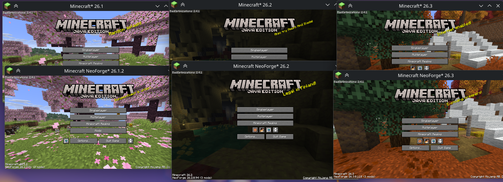
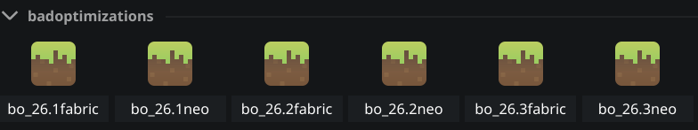
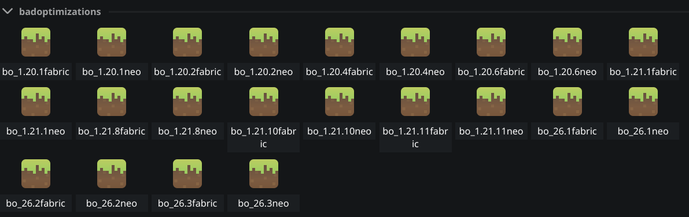

Testing?? Seriously?... Yes. Yes we must.

## How to test this
Once you have an active branch symlinked, you can use `:fabric:runClient` or `:forge:runClient` to test from Gradle.  
Except, that only tests the higher version boundary of the branch (i.e. only 1.21.8 in 1.20.6-1.21.8). What about the other versions?

### Prism testing
Hope you have PrismLauncher installed. 
The `gradle :testPrism` task builds the mod, then copies it to prism, then runs several versions of the game to make sure it all works. 
But it needs some setup beforehand.

### Properties of ~~water~~ gradle
You'll need to add some stuff to `$HOME/.gradle/gradle.properties`.  

`bo.prismInstancesDir` should be set to where your prism launcher's `instances` folder is.
```
# Windows
bo.prismInstancesDir=C:\Users\YOU\AppData\Roaming\PrismLauncher\instances
# macOS
bo.prismInstancesDir=/Users/YOU/Library/Application Support/PrismLauncher/instances
# Linux
bo.prismInstancesDir=/home/YOU/.local/share/PrismLauncher
# flatpak
bo.prismInstancesDir=/home/YOU/.var/app/org.prismlauncher.PrismLauncher/data/PrismLauncher/instances
```
`bo.prismBin` should be set to wherever your prism launcher binary is. Optionally set `bo.prismArgs` too.
```
# Windows
bo.prismBin=C:\Users\YOU\AppData\Local\Programs\PrismLauncher\prismlauncher.exe
# macOS
bo.prismBin=/Users/YOU/Applications/Prism Launcher.app/Contents/MacOS/prismlauncher
# Linux
bo.prismBin=/bin/prismlauncher
# Flatpak
bo.prismBin=/usr/bin/flatpak
bo.prismArgs=run org.prismlauncher.PrismLauncher

# on Linux, if you want to stop prism from using the internet
# so it doesn't check your account a million times
bo.prismBin=/usr/bin/unshare
bo.prismArgs=--user --net --map-root-user -- <rest-of-command>
# if you don't want it to ask your name, either, then go to manage accounts,
# and a new "offline" one, then select that
```
And set `bo.prismSequential` to either `true` or `false`.  
If it's true, then each prism instance for that branch will run one by one. 
The next instance will start when Minecraft and Prism are fully closed.  
If it's false, then all prism instances for that branch will launch at the same time.
If you do this, be sure to close most other applications on your computer, or at least have a fire extinguisher nearby.  


### Instances, served instan-taneously

Now we need to actually setup the instances that will be tested.
Look at `prismTests` in `branch/branch.versions.toml`:
```
# each one is prefixed with "bo_", for example "bo_26.1fabric", "bo_26.3neo"
# you can change this prefix by setting bo.prismBaseName in your properties
# it defaults to bo_
prismTests = "26.1fabric,26.1neo,26.2fabric,26.2neo,26.3fabric,26.3neo"
```
That one, for example, means you'll need six instances, named `bo_26.1fabric`, `bo_26.1neo`, `bo_26.1fabric` and so on.  
Make these instances in PrismLauncher with the correct version and loader:  
  
These are the instances you'd need if you were to test all branches:  


### And now, we run
...run `gradle :testPrism`. 

> [!WARNING]
> Make sure Minecraft and PrismLauncher are totally closed before running this.

The jar from `:assembleMonoJar` will be copied to these instances `mods` folder and then it'll be run. If there's a crash, the task will fail.